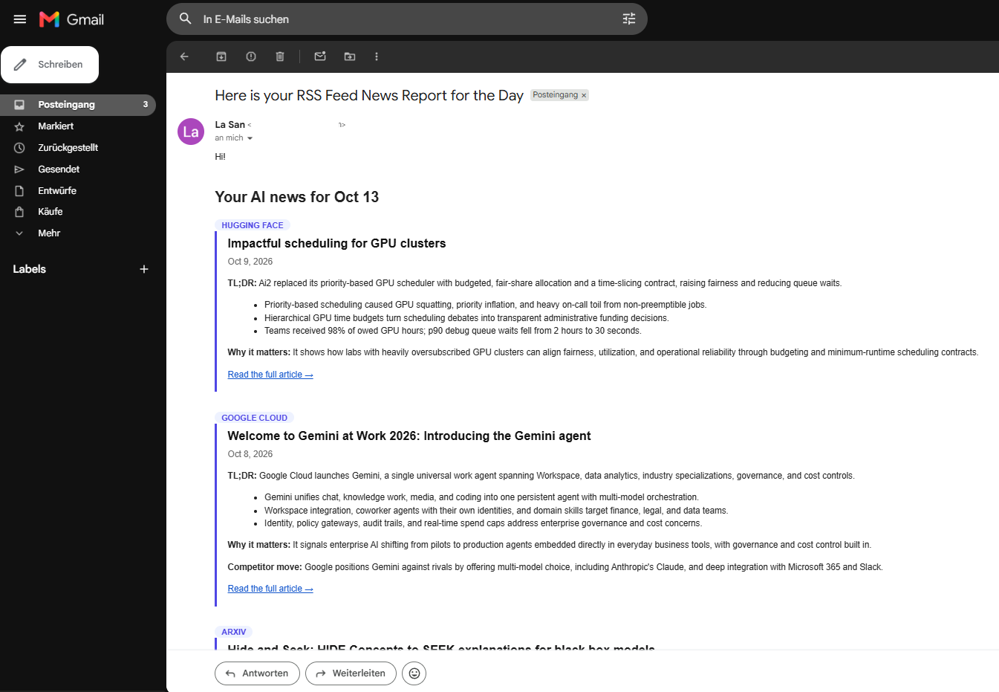
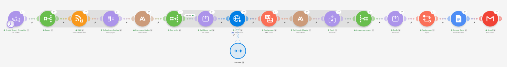

# AI News Digest (Make)

A daily email with the newest articles from different AI RSS Feed sources, each summarized in the same short format. Built in Make without writing code.

## Problem

Keeping up with AI news means checking many blogs and feeds, and most articles are long while the relevant point is often one sentence. The goal: one email each morning that says what happened and whether it matters, with a link to the full article.

## What it does

Every morning at 8:00 the scenario:

1. Checks several adjustable sources for articles published in the last 24 hours and takes the newest one per source. Example sources: arXiv (cs.LG), OpenAI, Google DeepMind, Google Cloud AI, Hugging Face, Microsoft Research, NVIDIA, AWS Machine Learning, TechCrunch AI.
2. Fetches the full article page and converts it to plain text.
3. Sends the text to Claude (Haiku 5.5) with a fixed output format: a one-sentence summary, three key takeaways, why it matters, and an optional line for regulatory change, competitor moves or challenges.
4. Collects all summaries into one HTML digest.
5. Saves the digest as a dated Google Doc (archive) and emails it with a link to the doc.

## Design decisions

- **Fallback instead of failure.** If the full article page can't be fetched, the scenario uses the summary from the RSS feed and continues, so one unreachable source doesn't stop the whole digest.
- **Fixed output format.** The prompt defines the exact HTML structure and word limits (max. 100 words per article), so every entry reads the same and the email stays scannable.
- **No filler lines.** The optional regulatory / competitor / challenge line only appears when the article covers it.
- **One article per source.** Keeps the digest short. Trade-off: on busy days, further articles from the same source are skipped.

## Limitations and next steps

- The page text includes navigation and footer content. The model filters it out, but it adds input tokens (around 3,800 for one article in a test run).
- No deduplication: if two sources cover the same announcement, it appears twice.
- Possible next step: let the model rank articles by relevance and drop low-value ones before the email is built.

## Stack

Make · RSS · HTTP · Claude API (Haiku 5.5) · Google Docs · Gmail
